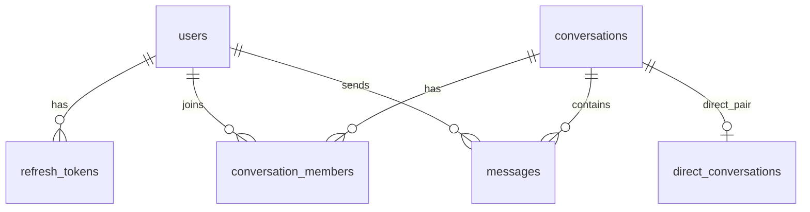

# 数据模型

## users

| 列                        | 类型        | 说明                |
| ------------------------- | ----------- | ------------------- |
| id                        | uuid PK     | `gen_random_uuid()` |
| email                     | text        | 唯一，注册时转小写  |
| username                  | text        | 唯一                |
| password_hash             | text        | Argon2id            |
| display_name / avatar_url | text        | 可空                |
| created_at / updated_at   | timestamptz |                     |
| deleted_at                | timestamptz | 软删除              |

索引：`users_email_unique`、`users_username_unique`。

## refresh_tokens

| 列              | 类型        | 说明                       |
| --------------- | ----------- | -------------------------- |
| id              | uuid PK     |                            |
| user_id         | uuid FK     | 级联删除                   |
| token_hash      | text        | 只存 SHA-256，不存原 token |
| expires_at      | timestamptz | 30 天                      |
| revoked_at      | timestamptz | 轮换/登出                  |
| user_agent / ip | text        | 审计                       |

索引：hash 唯一、`user_id` 普通索引。

## conversations

| 列                      | 类型        | 说明                         |
| ----------------------- | ----------- | ---------------------------- |
| id                      | uuid PK     |                              |
| type                    | enum        | `direct` / `group`           |
| title                   | text        | 群聊必填                     |
| created_by              | uuid FK     |                              |
| last_seq                | bigint      | **每会话消息序号**，行锁自增 |
| created_at / updated_at | timestamptz |                              |

## conversation_members

| 列                    | 类型        | 说明                         |
| --------------------- | ----------- | ---------------------------- |
| conversation_id       | uuid FK     | 复合主键                     |
| user_id               | uuid FK     | 复合主键                     |
| role                  | enum        | `owner` / `admin` / `member` |
| joined_at             | timestamptz |                              |
| last_read_seq         | bigint      | 已读游标                     |
| muted_until / left_at | timestamptz | 退群写 `left_at`             |

索引：`conversation_members_user_id_idx`。

## messages

| 列                     | 类型        | 说明                     |
| ---------------------- | ----------- | ------------------------ |
| id                     | uuid PK     |                          |
| conversation_id        | uuid FK     | 级联删除                 |
| sender_id              | uuid FK     |                          |
| seq                    | bigint      | 会话内递增               |
| client_msg_id          | text        | 客户端幂等键             |
| type                   | enum        | `text` / `system`        |
| body                   | text        | 软删后仍保留（接口过滤） |
| reply_to_id            | uuid FK     | 自引用，删除置空         |
| edited_at / deleted_at | timestamptz | 软删除                   |
| created_at             | timestamptz |                          |

约束：

- 唯一 `(conversation_id, seq)`
- 唯一 `(sender_id, client_msg_id)`
- 索引 `(conversation_id, seq)`

## direct_conversations

| 列                    | 类型        | 说明                     |
| --------------------- | ----------- | ------------------------ |
| user_a_id / user_b_id | uuid        | 复合主键，按字典序规范化 |
| conversation_id       | uuid        | 唯一                     |
| created_at            | timestamptz |                          |

用于保证同一对用户只有一个私聊；并发创建由唯一约束兜底。

## 关键约定

- **seq**：发送消息时先 `update conversations set last_seq = last_seq + 1 returning last_seq`，行锁保证同会话串行
- **未读数**：`count(messages where seq > last_read_seq and sender_id <> 自己)`
- **分页**：`seq` 游标，不用 offset
- **软删除**：`deleted_at`，列表过滤
- **时间**：全部 UTC（timestamptz）
